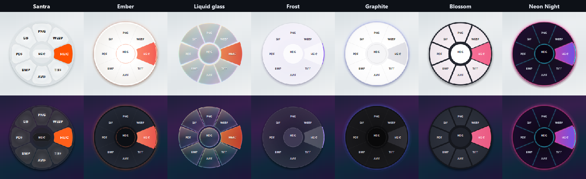

# ShiftWheel

**Drag a file, tap a key, drop it on the wheel.** Convert it, compress it, edit it, print it or share it, right where you are. Everything happens on your computer; nothing is uploaded.

This page has downloads and release notes. The source code isn't kept here.

## Download

**[Get the latest version](https://github.com/Aditya-Prakash-047/ShiftWheel-releases/releases/latest)**

| File | For |
|---|---|
| `ShiftWheel-Setup.exe` | Windows 10/11 (recommended) |
| `ShiftWheel.exe` | Windows, portable, no install |
| `ShiftWheel-mac-apple-silicon.dmg` | macOS 11+, M1 and later |
| `ShiftWheel-mac-intel.dmg` | macOS 11+, Intel |

## Install

**Windows:** run `ShiftWheel-Setup.exe`. No admin rights needed. The app isn't code-signed yet, so choose **More info → Run anyway** the first time.

**macOS:** open the `.dmg` and drag ShiftWheel onto Applications. The app isn't notarized yet: open it once, then go to **System Settings → Privacy & Security → Open Anyway**.

## Use it

1. Start dragging a file in File Explorer or Finder.
2. While dragging, tap **Shift** to convert, **Ctrl** (Command on a Mac) for tools, or **Alt** (Control on a Mac) for actions.
3. Drop it on a slice. The result is saved next to the original, which is never changed.

Or select a file and press **Ctrl+Alt+W**. Keys, themes, sounds and more are in Settings, from the tray or menu-bar icon.

## Updates

ShiftWheel checks this page once a day, verifies the download's SHA-256 and installs it. You can turn this off in Settings → Behaviour.

## More

- [What's changed](CHANGELOG.md)
- [Licence](LICENSE)
